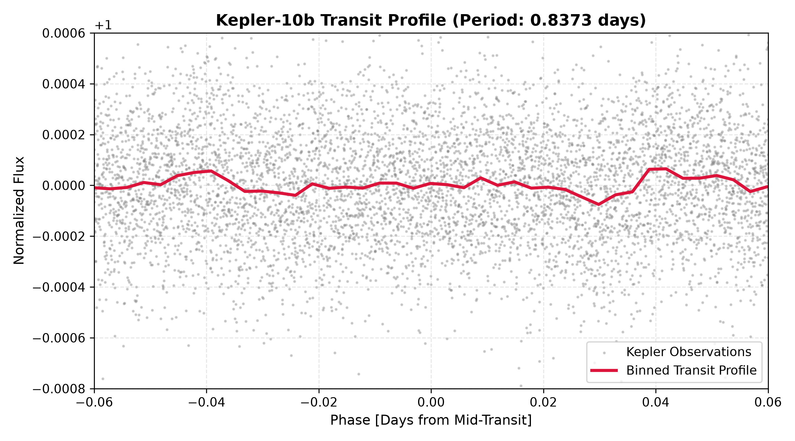

# Exoplanet Transit Hunter

A computational astrophysics pipeline utilizing NASA Kepler photometric observations to isolate exoplanetary transit signatures, derive orbital periods via Box Least Squares (BLS) periodograms, and compute physical planetary radii using transit depth models.

---

## Astrophysical Principles

### 1. Transit Depth & Planetary Radius
When an exoplanet transits between its host star and the observer, it blocks a portion of the projected stellar disk area ($A_\star = \pi R_\star^2$). Assuming the planet is an opaque disk of radius $R_p$, the fractional flux decrease ($\delta$) is given by:

$$\delta = \frac{\Delta F}{F_\text{baseline}} \approx \left(\frac{R_p}{R_\star}\right)^2 \implies R_p = R_\star \sqrt{\delta}$$

### 2. Semi-Major Axis (Kepler's Third Law)
Using the orbital period $P$ extracted from the light curve and stellar mass $M_\star$:

$$a = \left(\frac{G M_\star P^2}{4\pi^2}\right)^{1/3}$$

### 3. Box Least Squares (BLS) Detection
Unlike sinusoidal signals best handled by Fourier analysis, planetary transits are characterized by periodic, inverted square-well profiles. The BLS algorithm models the light curve as an alternating two-level step function over a grid of trial periods:

$$\text{Model}(t) = \begin{cases}  1 - \delta & \text{during transit window} \\  1 & \text{out of transit}  \end{cases}$$

The algorithm maximizes signal power to identify the true orbital period, transit epoch, and event duration.

---

## Kepler-10b Extraction Results

* **Host Star:** Kepler-10 ($R_\star \approx 1.065\,R_\odot$)
* **Target Exoplanet:** Kepler-10b
* **Detected Orbital Period ($P$):** 0.83735 days (~20.1 hours)
* **Transit Duration:** 1.68 hours
* **Derived Planetary Radius ($R_p$):** 0.44 Earth Radii (single-quarter estimate)



---

## Pipeline Overview

1. **Photometry Acquisition:** Downloads Pre-search Data Conditioning Simple Aperture Photometry (PDCSAP) flux from NASA MAST.
2. **Stellar Detrending:** Applies a Savitzky-Golay filter to isolate low-frequency stellar activity (e.g., starspots, rotation) and normalize baseline flux to 1.0.
3. **Periodogram Search:** Executes a BLS scan over trial frequencies to detect repeating transit events.
4. **Phase Folding & Binning:** Stacks periodic observations to increase signal-to-noise ratio by averaging out Gaussian instrumentation noise.
5. **Physical Derivations:** Computes planetary radius in Earth radii using physical solar constants via `astropy`.

---

## Setup & Execution

### 1. Clone the Repository
```bash
git clone [https://github.com/](https://github.com/)<your-username>/exoplanet-transit-hunter.git
cd exoplanet-transit-hunter